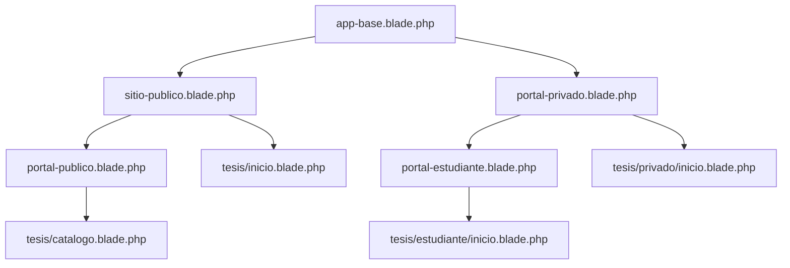

# Arquitectura de plantillas Blade

## Herencia



## Cómo usarlas

**Sitio público:**

```blade
@extends('layouts.sitio-publico')
@section('titulo', 'Nuestra oferta')
@section('contenido')
    <h1>Oferta formativa</h1>
@endsection
```

**Portal público:**

```blade
@extends('layouts.portal-publico')
@section('titulo', 'Catálogo')
@section('encabezado_portal', 'Todos los cursos')
@section('contenido_portal')
    <p>Aquí renderiza el listado enviado desde el controlador.</p>
@endsection
```

**Portal privado:**

```blade
@extends('layouts.portal-privado')
@section('titulo_panel', 'Operaciones')
@section('contenido_privado')
    <h2>Área protegida por middleware y policies</h2>
@endsection
```

**Portal estudiante:**

```blade
@extends('layouts.portal-estudiante')
@section('contenido_estudiante')
    <h2>Mis módulos</h2>
@endsection
```

## Autorización y reutilización

No utilices cinco vistas idénticas para cada rol. En un componente o vista común, puedes controlar acciones con Laravel Gates/Policies:

```blade
@can('update', $curso)
    <a href="{{ route('cursos.edit', $curso) }}">Editar curso</a>
@endcan
```

Este fragmento **requiere** que existan el modelo `$curso`, la policy y la ruta; es un ejemplo para implementación futura. Proteger un botón NO protege un endpoint: aplicar autorización también en el servidor.

## Integración a producción

- Quitar rutas `/_demo-tesis` y vincular controladores reales.
- Limitar las rutas privadas con `auth`, autorización por permisos y aislamiento por institución.
- Sustituir contenido de ejemplo por DTOs/colecciones desde controladores.
- Procesar el formulario de solicitud de acceso con validación, almacenamiento privado y cola de correos.
- Al llegar a Vite, migrar CSS desde `public/css/tesis-ui.css` a `resources/css/` y registrarlo en el frontend build; hacerlo solo cuando el proyecto lo necesite.
- Mantener layouts, componentes SVG y tokens de diseño en un mismo lugar.
